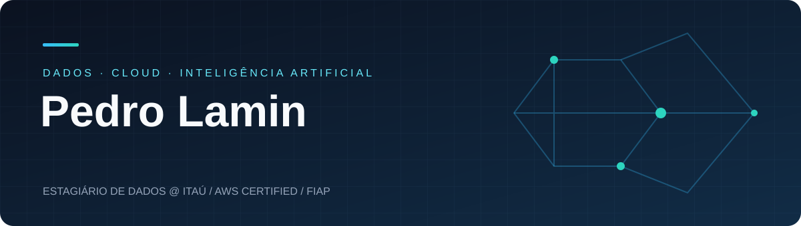
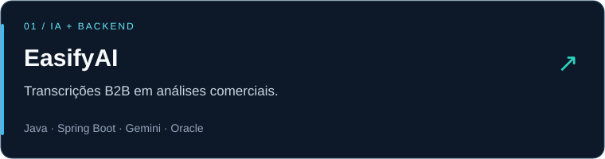
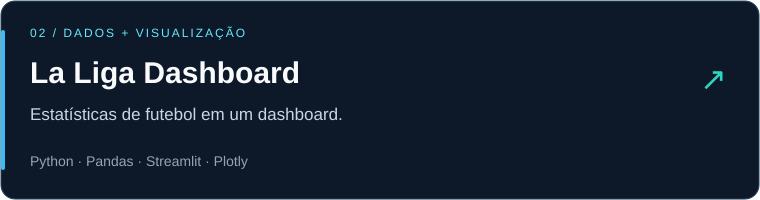
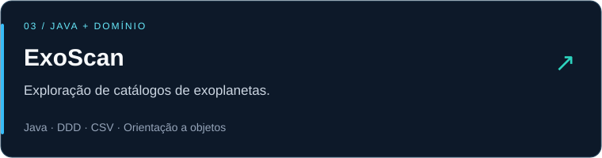

  

  

  
  
  

### Um pouco sobre mim

Sou **Pedro**, estagiário de Dados no **Itaú**, estudante de Engenharia de Software na **FIAP** e técnico em Redes de Computadores pelo **IFSP**. Trabalho com dados, automações e integrações e estou construindo minha carreira em **Engenharia de Dados**.

**AWS Certified Cloud Practitioner** · AI Practitioner em preparação para dezembro/2026  
Aprofundando **Spark, pipelines de dados e IA generativa**.

---

### Tecnologias

  

  
  
  
  
  

  <b>Cloud:</b> AWS 
  <b>Automação:</b> Power Automate · Power Apps · SharePoint

### Projetos em destaque

  
    
  
    
  

  <a href="https://github.com/plamin/easify">EasifyAI</a> · <a href="https://github.com/plamin/graficos-laliga">La Liga Dashboard</a> · <a href="https://github.com/plamin/exoplaneta-ddd-java">ExoScan</a>

---

  <b>Dados, código e aprendizado contínuo.</b>  
  <a href="https://www.linkedin.com/in/pedro-lamin/">Vamos conversar no LinkedIn ↗</a>

